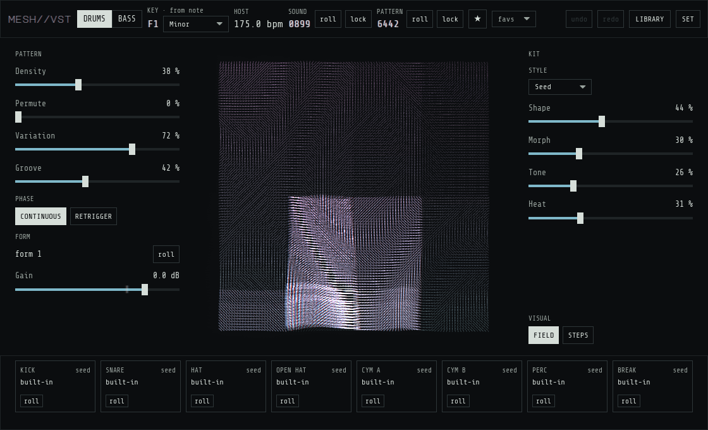
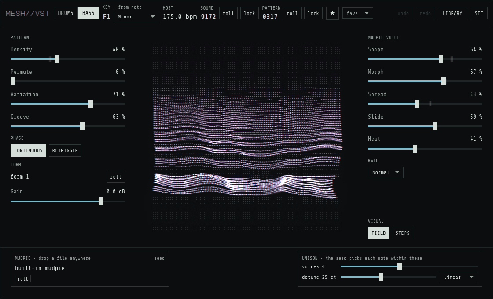

<div align="center">

```
M E S H // V S T
```

**an abstract pattern machine for drums and bass**

`seed` · `roll` · `listen` · `keep`

</div>

---

mesh is controlled chaos. You hold a note and it plays: breakbeat drums, or a bass line made
from a sound of your own, always in time and in key. It does not wait for you to write
anything. It finds the grooves and lays them out into a whole track arrangement, with
build-ups, breaks and returns, while you listen and steer.

Roll the dice and you hear something new. Most rolls you skip. Some you keep and build a track
on. Every roll can be found again, so what you keep stays yours.

<p align="center"></p>

### what you do

- **steer, don't write.** A few knobs, each moving many things at once: how busy, how far the
  parts drift apart, how much changes over time, how it swings, how hard it hits. Their middle
  is always the machine's own suggestion.
- **keep what you like.** Lock a sound, lock a groove, pin the parts that work and roll the
  rest.
- **step in when you want.** Open a groove and change it by hand, or take the arrangement into
  your DAW and play it from your own clip. The machine keeps its character either way.

<p align="center"></p>

### what it feels like

- **surprise with a shape.** It wanders, but it never loses the thread: ideas come back,
  answer each other and change at the moments a track would.
- **limits are the point.** Few controls leave more room to listen.
- **your sounds.** Point it at your sample folders. It sorts them into kits by itself, and you
  can drop files onto any slot.
- **it plays the same twice.** Loops, bounces and recalls play exactly what you heard, every
  setting can be automated, and undo covers all of it.

Made for producers of breakbeat, jungle, dnb, bass music and anything stranger. Free and open
source (GPL-3.0), no accounts, no upsell.

---

### get it

**[→ releases](https://github.com/dataO1/mesh-vst/releases)** · CLAP and VST3 · Linux and Windows

1. Unzip the release.
2. Copy `mesh vst.clap` and `mesh vst.vst3` to your plugin folders:
   - Linux: `~/.clap` and `~/.vst3`
   - Windows: `C:\Program Files\Common Files\CLAP` and `...\VST3`
3. Load it on an instrument track, hold one long note, and start rolling.
4. Optional: open **SET** in the plugin and add your sample folders.
5. Optional: put your own bass riffs as MIDI files in `~/.config/mesh-vst/clips/a`, `b`, `c`
   and `d` (one folder per letter, any key and length). The bass plays them when its SOURCE
   is CLIPS, the default.

<sub>building from source, tests and dev notes: [docs/building.md](docs/building.md) · design: [docs/design.md](docs/design.md) · music theory: [docs/music-theory.md](docs/music-theory.md)</sub>
